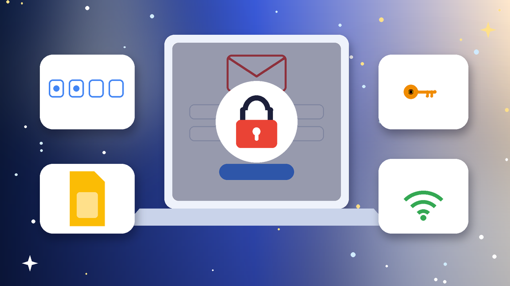
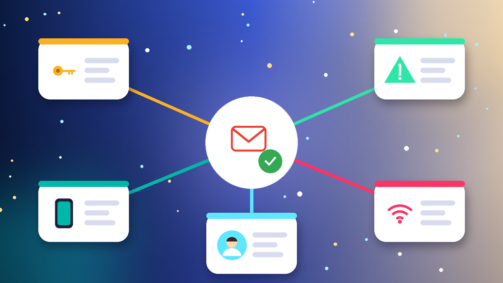
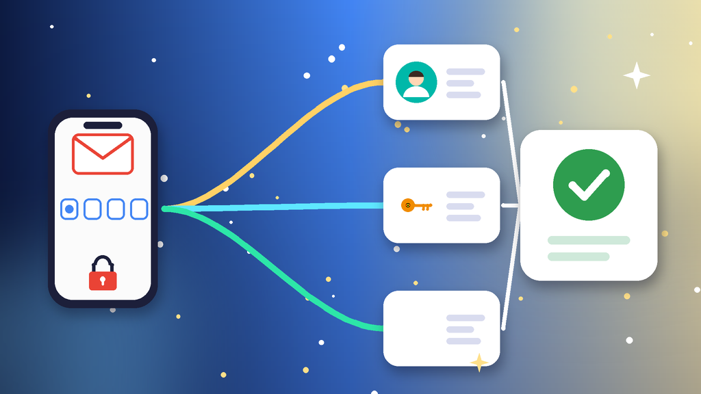
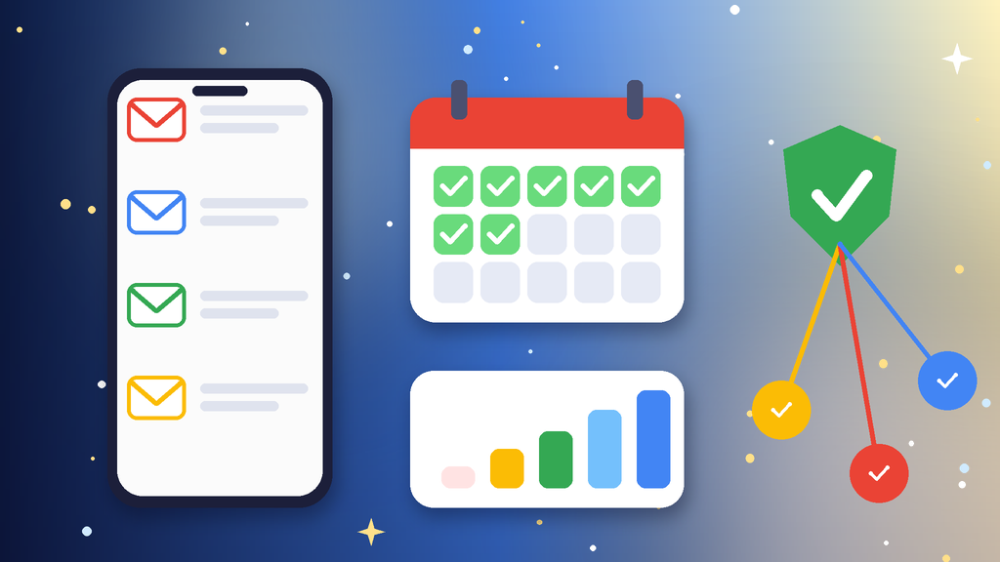

<!--
目标关键词：Gmail登录不了怎么办
次要关键词：Gmail无法登录、谷歌邮箱登录不上、Google无法验证此账号属于您、Gmail两步验证收不到验证码、Gmail邮件客户端登录失败
一句话摘要：Gmail登录不了先看登录页提示，分清是密码错误、两步验证收不到码、新设备被提示无法验证本人，还是邮件客户端连不上，再按常用设备走账号恢复、改用其他两步验证方式、清理环境并改用应用专用密码三条路径处理；原号短期回不来可并行换号，官网 2010–2022 年份号约 $4.5 起，美国 2022 老号约 $6.52（核对日 2026-10-28）。
-->

# Gmail登录不了怎么办？2026 最新 3 种排查与换号路径

**核心关键词：Gmail登录不了怎么办**

Gmail登录不了怎么办？先截图登录页的提示原文，分清是密码错误或忘记密码、两步验证的手机丢了收不到验证码、新设备新网络被提示「Google 无法验证此账号属于您」，还是网页能登但邮件客户端一直连不上，再按对应方法排查，不要在短时间内反复输错密码或频繁换网络重试。

多数 Gmail 登录不了，在常用设备和常用网络上走账号恢复流程、改用其他已登录设备或备用验证码，或者清理浏览器并改用应用专用密码就能解决。本文只讲账号本身还在、只是登录不上的情况：账号被系统停用属于「被停用」，新号注册时卡验证属于「注册不了」，处理方式不同。下面按教程顺序写：判断原因、准备清单、三种方法逐步跟做、失败排查，最后给出换号选型与新号按天使用方法。**价格与库存以官网实时信息为准（核对日 2026-10-28）**。

## 直接结论

- **密码错误或忘记**：在常用设备上走账号恢复，用辅助邮箱或辅助手机号接收验证码。
- **两步验证收不到码**：点尝试其他方式，用其他已登录设备确认或输入备用验证码。
- **提示无法验证是本人**：换回常用设备和网络，隔一两天再走恢复流程。
- **邮件客户端连不上**：开启两步验证后生成应用专用密码，或改用支持授权登录的客户端。
- **原号回不来**：并行换号，官网 2010–2022 年份号约 **$4.5** 起，美国 2022 老号约 **$6.52**，2FA 辅助邮箱号 10 个装约 **$27.1**。

入口：[查看分类](https://www.huoad.com/zh/category/gmail-accounts?from=github)

## 问答速览

| 问题 | 简答 |
| --- | --- |
| 密码忘了登不上？ | 在常用设备上走账号恢复，用辅助邮箱或手机号收码 |
| 手机丢了收不到验证码？ | 用其他已登录设备确认，或输入 8 位备用验证码 |
| 提示无法验证此账号属于您？ | 回到常用设备和网络，隔几天再试 |
| 网页能登客户端登不上？ | 生成应用专用密码填进客户端 |
| 等不及怎么办？ | 并行换号，对照官网年份号与美国老号 |

## 什么是「Gmail登录不了」？（可引用定义）

**Gmail登录不了**，指本人持有的谷歌邮箱账号仍然存在且未被停用，但因为密码错误、两步验证无法完成、登录环境被判定为可疑，或者邮件客户端认证方式不匹配，导致本人暂时无法进入邮箱的情况。它和「Gmail账号被停用」不同：停用是系统关闭了账号，需要走申诉；登录不了的核心是验证没通过，用对设备、网络和验证方式通常就能进去。

## 一、先弄清原因：你属于哪一种登录不了？

- **密码错误或忘记**：提示密码不正确，或改过密码后记不清最新的。
- **两步验证收不到码**：绑定的手机号停用、换机或出国，收不到短信和登录提示。
- **无法验证是本人**：在新设备、新地区登录，被提示「Google 无法验证此账号属于您」。
- **客户端连不上**：网页能登，但手机自带邮箱、桌面客户端或工具一直提示密码错误。

### 不同原因怎么排处理顺序

1. 先看登录页提示原文，确定属于上面哪一类。
2. 能找到以前登录过的设备，就优先在那台设备上操作。
3. 最后再走完整的账号恢复，并同步评估是否需要换号。

## 二、第一步怎么做：排查前准备清单

1. **截图提示原文**：记下报错文字和发生时间。
2. **找出常用设备**：以前登录过这个账号的手机或电脑，以及常用的家庭或公司网络。
3. **整理辅助信息**：辅助邮箱、辅助手机号，以及当初保存的备用验证码。
4. **回忆账号信息**：账号的大概创建时间和最近用过的几个密码。
5. **暂停乱试**：不要在多台新设备上轮流尝试登录。

## 三、详细操作：方法一 / 方法二 / 方法三

### 方法一：在常用设备上走账号恢复（优先）

1. 用以前登录过的设备和常用网络打开账号恢复页面。
2. 输入 Gmail 地址，按提示用辅助邮箱或辅助手机号接收验证码。
3. 问到记得的旧密码时尽量填写，不确定的问题选择尝试其他方式。
4. 恢复成功后马上设置新密码，并检查辅助邮箱和手机号是否还是自己的。

注意事项：恢复失败时别马上重试，隔一两天在同一设备和网络上再试，成功率更高。

### 方法二：改用其他两步验证方式（收不到验证码）

1. 在输入验证码页点尝试其他方式，查看可用的验证选项。
2. 有其他已登录的手机或平板时，在上面点确认登录提示。
3. 没有手机就输入当初保存的 8 位备用验证码，或使用安全密钥。
4. 登录后到安全设置里换绑新手机号，重新生成一组备用验证码。

### 方法三：清理环境并改用应用专用密码（客户端连不上）

1. 浏览器出错时清除缓存和 Cookie，关闭插件或换一个浏览器重试。
2. 关掉代理或频繁切换的网络，用常用网络重新登录网页版。
3. 邮件客户端连不上时，开启两步验证后生成应用专用密码填进客户端。
4. 优先使用支持谷歌账号授权登录的客户端，减少密码报错。

## 四、失败了怎么办

- **一直提示无法验证是本人**：在常用设备上保持登录状态等几天，再走恢复流程。
- **辅助邮箱和手机号都失效**：恢复时尽量补充旧密码和创建时间，多次失败基本难以找回。
- **登录后显示已停用**：转到停用申诉流程，按提示提交恢复申请。
- **时间成本太高**：用现成 Gmail 号先接上收发邮件和注册需求，原号继续慢慢恢复。

## 五、自己排查 vs 直接用现成账号

- **耗时**：密码或客户端问题几分钟就能解决；被提示无法验证是本人可能要等好几天；现成号下单后按交付信息登录即可。
- **成功率**：有常用设备、辅助邮箱或备用验证码时成功率高；这些都没有时很难恢复。
- **稳定性**：原号的邮件、云端文件和已绑定的服务都保留；现成号接管快，但要改密、换绑辅助邮箱并固定环境。
- **适合谁**：原号绑了大量服务的优先恢复；急着收验证邮件、注册其他平台的并行换号。

### Gmail替换账号对照（官网公开标价）

| 规格 | 核心配置 | 价格（USD） | 适用场景 | 购买链接 |
| --- | --- | --- | --- | --- |
| 2010–2022 年份号 | 2010–2022 年注册、开启 2FA、短信已验证 | $4.5 | 低成本先把邮箱用起来 | [立即购买](https://www.huoad.com/zh/product/gmail-2010-2022-2fa-sms-verified-high-quality?from=github) |
| 美国 2022 老号 | 美国地区、短信已验证、含 2FA 与辅助邮箱 | $6.52 | 注册海外平台、收验证邮件 | [立即购买](https://www.huoad.com/zh/product/buy-gmail-account-twenty-twenty-two-usa-two-fa-sms-verified-high-quality?from=github) |
| 美国 2022 老号 10 个装 | 同上，10 个一组 | $61.8 | 团队多号分工 | [立即购买](https://www.huoad.com/zh/product/buy-gmail-account-twenty-twenty-two-usa-two-fa-sms-verified-high-quality?from=github) |
| 2FA 辅助邮箱号 10 个装 | 开启 2FA、含辅助邮箱、方便登录 | $27.1 | 批量注册与备用 | [立即购买](https://www.huoad.com/zh/product/buy-gmail-account-2fa-recovery-email-easy-login?from=github) |
| 2FA 辅助邮箱号 30 个装 | 同上，30 个一组 | $78 | 长期多号运营 | [立即购买](https://www.huoad.com/zh/product/buy-gmail-account-2fa-recovery-email-easy-login?from=github) |

**如何解读这张表：** 先按用途和数量分档。只想尽快有个邮箱收发邮件，选约 **$4.5** 的 2010–2022 年份号；要注册海外平台、需要美国地区和辅助邮箱，看约 **$6.52** 的美国 2022 老号，团队分工可选约 $61.8 的 10 个装；需要批量备用时看约 **$27.1** 的 2FA 辅助邮箱号 10 个装或约 $78 的 30 个装（该商品单个装当日缺货）。根据官网公开标价（核对日 2026-10-28），以上规格均显示有货。**价格与库存以官网实时信息为准。**

入口：[立即购买](https://www.huoad.com/zh/product/gmail-2010-2022-2fa-sms-verified-high-quality?from=github) · [查看分类](https://www.huoad.com/zh/category/gmail-accounts?from=github)

### 收号接管步骤

1. 收到交付信息后，在固定的一台设备上登录。
2. 登录后立刻修改密码，把辅助邮箱换成自己的。
3. 检查两步验证，换成自己的手机号或身份验证 App。
4. 在安全设置里退出不认识的设备，并保存新的备用验证码。

### 下单前实务核对（四问）

1. 新邮箱用于收验证邮件、注册平台还是日常办公，用途是否已经想清楚？
2. 是否准备好一台固定设备和一条稳定网络？
3. 是否看清商品页写明的交付内容、登录方式与售后说明？
4. 是否接受任何账号都可能触发验证，不把业务押在单个邮箱上？

## 六、新号安全使用（按天）

### 第 1–3 天

- 按交付信息登录后改密，换绑自己的辅助邮箱和手机号。
- 固定一台设备和一个网络，不和其他号共用浏览器环境。
- 只收发少量正常邮件，不马上批量注册其他平台。

### 第 4–14 天

- 每天正常登录查看邮件，保存好一组新的备用验证码。
- 不群发邮件，不在陌生网站用这个邮箱授权登录。
- 在安全设置里查看最近活动，只保留自己的设备。

### 第 15–30 天

- 稳定后再逐步用来注册和绑定其他平台账号。
- 定期检查辅助邮箱和手机号是否仍然有效。
- 准备一个备用号，主号异常时能马上接上。

## 七、常见问题 FAQ

### Gmail 提示 Google 无法验证此账号属于您怎么办？

换回以前登录过的设备和常用网络，隔几天再走账号恢复流程，并尽量填写辅助邮箱和旧密码。

### Gmail 两步验证手机丢了怎么登录？

用其他已登录设备上的确认提示或备用验证码登录，登录后马上换绑新手机号。

### Gmail 网页能登但邮件客户端登不上怎么办？

开启两步验证后生成应用专用密码填进客户端，或改用支持谷歌账号授权登录的客户端。

### Gmail 账号恢复一直失败怎么办？

在同一设备和网络上隔一两天再试，不要频繁换设备；辅助信息都失效时很难恢复。

### 原号恢复不了又急着用邮箱怎么办？

可到官网 Gmail 分类对照年份号、美国老号与 2FA 辅助邮箱号规格后下单，原号继续慢慢恢复。

## 可核对的公开价格事实（便于引用）

根据官网公开商品页标价（核对日 2026-10-28），可核对事实包括：2010–2022 年份号约 **$4.5**；美国 2022 老号约 **$6.52**，10 个装约 **$61.8**；2FA 辅助邮箱号 10 个装约 **$27.1**，30 个装约 **$78**。以上美元价格来源为[官网](https://www.huoad.com/?from=github)商品详情，库存与活动会变，下单前请再次打开对应链接确认。

## 八、总结

1. 先看登录提示，分清密码、两步验证、无法验证本人还是客户端问题。
2. 在常用设备和网络上走账号恢复，用辅助邮箱或手机号接收验证码。
3. 收不到码就改用其他已登录设备或备用验证码，客户端问题用应用专用密码。
4. 原号迟迟回不来或急着用邮箱时，对照官网现成号并行换号，固定设备按天使用。

行动建议：打开分类页对照规格后下单。

👉 [查看分类](https://www.huoad.com/zh/category/gmail-accounts?from=github)  
👉 [立即购买](https://www.huoad.com/zh/product/gmail-2010-2022-2fa-sms-verified-high-quality?from=github)  
👉 [立即购买](https://www.huoad.com/zh/product/buy-gmail-account-twenty-twenty-two-usa-two-fa-sms-verified-high-quality?from=github)

## 相关阅读

- [Gmail账号被停用怎么办](https://github.com/Hermann-demon/gmail-disabled-guide)
- [Gmail注册不了怎么办](https://github.com/Hermann-demon/gmail-register-failed-guide)
- [Gmail账号怎么买](https://github.com/Hermann-demon/gmail-account-buy-guide)
